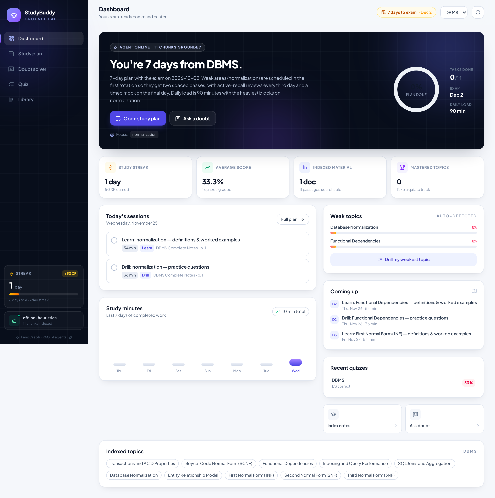
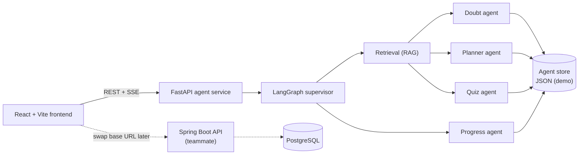
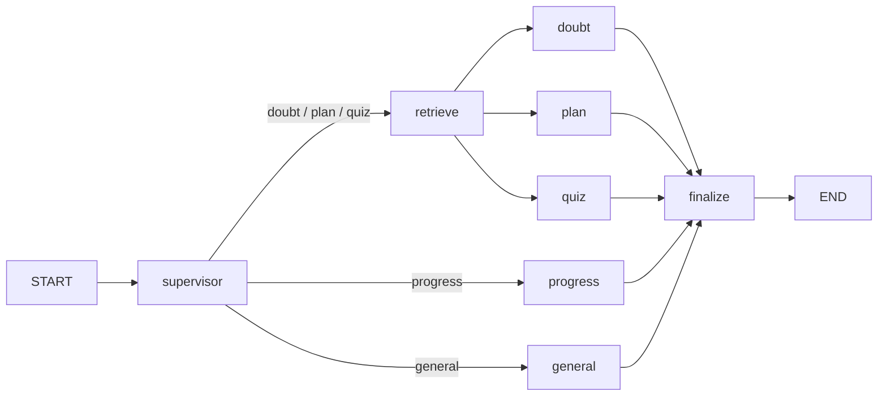
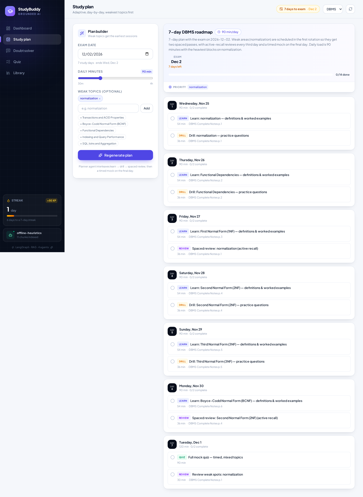
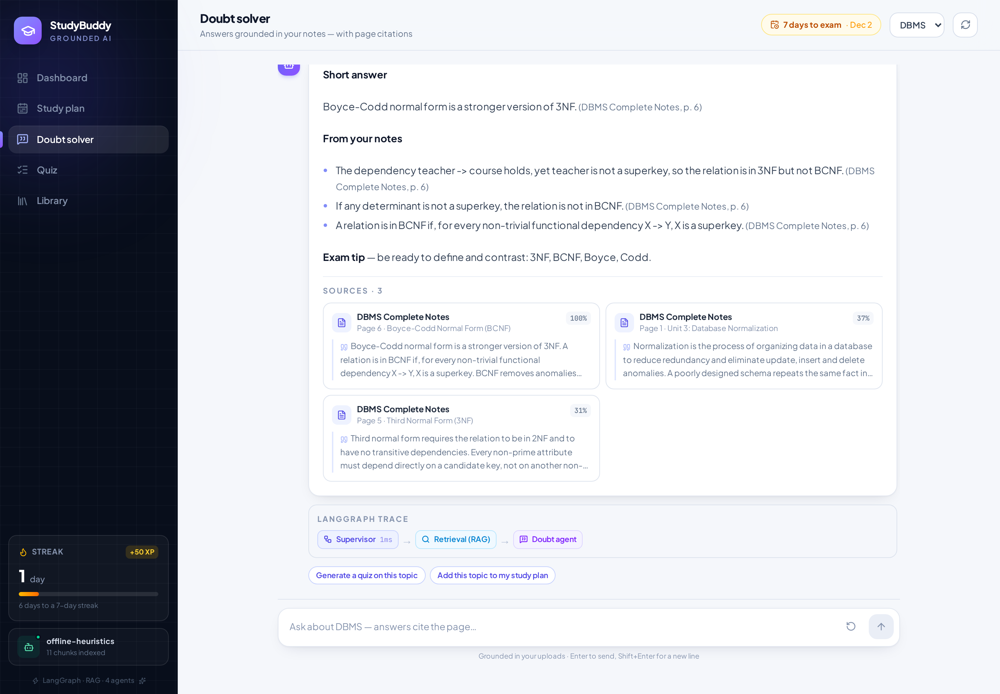
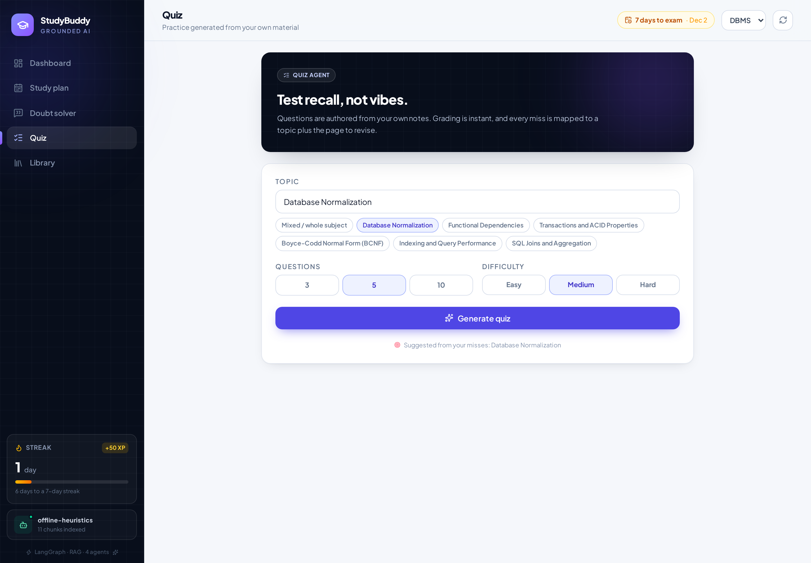
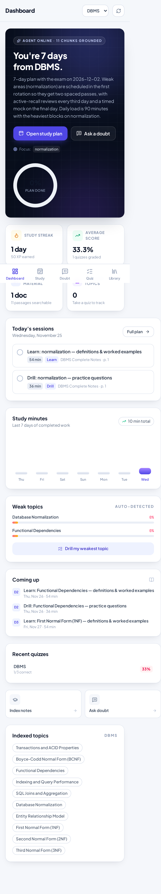

# StudyBuddy AI

**Personalized learning & source-cited doubt agent** — turns scattered syllabus PDFs and class notes into an adaptive study plan, automated quizzes, and grounded answers that cite the exact page.

Built for the *AI + Java Hackathon — Problem Statement #07* (LangGraph + Spring Boot). This repository contains the **AI agent track + frontend**. The Spring Boot backend is owned by the Java teammate; the UI is already wired to a swappable API adapter so it can move from the agent service to the Java API without component changes.



---

## What works today

| Pitch promise | Implementation |
| --- | --- |
| Unified RAG hub | Page-aware PDF/TXT/MD ingestion, heading detection, ~900-char overlapping chunks |
| Cited doubt solving | Hybrid BM25 (+ optional embeddings) retrieval, answers only from your notes, refuses to guess |
| Adaptive roadmaps | Deterministic planner weighted toward weak topics, spaced review every 3rd day, timed mock on the final day |
| Automated quizzes | MCQ authoring from your own material (definitions + cloze), instant grading, per-topic mastery |
| Progress & streaks | Attempt history, weak-topic detection, XP, streak, weekly minutes |
| Multi-agent orchestration | LangGraph supervisor routing to **doubt / planner / quiz / progress** agents with a live trace |

Works **with zero credentials** (deterministic offline agents). Add an OpenAI-compatible key to upgrade answer phrasing, quiz authoring and coaching feedback.

---

## Architecture



**Golden rule from the pitch:** Java is the source of truth; the AI agents only *propose* structured actions. Every agent response is already a typed JSON object (`StudyPlan`, `Quiz`, `GradeResult`) that the Spring Boot service can persist as-is.

### LangGraph graph



- **Supervisor** — rule-based intent routing plus slot extraction (`7 days`, `weak in normalization`, `quiz me on BCNF`, difficulty, question count).
- **Retrieval** — BM25 over heading-aware chunks; cosine blend when `EMBEDDING_MODEL` is configured.
- **Doubt** — extractive offline answer with `(Doc, p. N)` citations; LLM path enforces `NOT_IN_NOTES` when unsupported.
- **Planner** — deterministic scheduler (weak topics first, interleaved drills, spaced recall, final mock) + optional LLM rationale.
- **Quiz** — LLM authoring with offline definition/cloze fallback; grading maps misses to topics and pages.
- **Progress** — streak, XP, mastery and coaching summary.
- Checkpointed with LangGraph `MemorySaver` per `thread_id`, so follow-up questions keep context.

---

## Quick start

### Windows — one click

Double-click **`Start StudyBuddy.bat`** in the project root. On the first run it
installs `uv` (if missing), syncs the Python environment, builds the UI, starts
the server on **http://localhost:8000** and opens your browser. Everything is
seeded with the bundled DBMS notes, so no API key is needed.

```bat
Start StudyBuddy.bat              :: built UI on :8000
Start StudyBuddy.bat -Dev         :: Vite dev server with hot reload on :5173
Start StudyBuddy.bat -Port 8080   :: serve on another port
```

Requires Python 3.12+ and Node 20+. Afterwards the fast path is just
`uv run studybuddy serve` from a terminal.

### Option A — one command (development)

```bash
cp .env.example .env          # optional: add an LLM key
./scripts/dev.sh              # API :8000 + UI :5173
```

Open **http://localhost:5173**. The bundled DBMS notes are indexed automatically on first boot.

### Option B — single process (demo / judges)

```bash
cd frontend && npm install && npm run build && cd ..
uv run studybuddy serve       # http://localhost:8000
```

FastAPI serves the built SPA at `/` and the API at `/api/*`.

### Terminal demo (no browser)

```bash
uv run studybuddy demo
```

Runs ingest → cited doubt → 7-day plan → 5-question quiz → grading → progress.

### Requirements

- Python 3.12+ with [uv](https://docs.astral.sh/uv/)
- Node 20+

---

## 90-second demo script

1. **Library** → upload a DBMS PDF (or use the seeded *DBMS Complete Notes*, 10 pages).
2. **Doubt solver** → *"Explain BCNF and why it is stronger than 3NF."*
   → grounded answer, 3 source cards with page numbers, LangGraph trace.
3. **Study plan** → exam date +7, weak topic `normalization` → generate.
   → day-wise roadmap, normalization first, spaced review, mock on the last day.
4. **Quiz** → *BCNF*, 5 questions, medium → answer → submit.
   → instant score, weak-topic mapping, per-question page citations.
5. **Dashboard** → streak, average, weak topics, weekly minutes all updated.

---

## API reference

| Method | Path | Purpose |
| --- | --- | --- |
| `GET` | `/api/health` | Service + agent status |
| `GET` | `/api/agent/status` | LLM mode, model, chunk count, topics |
| `GET` | `/api/agent/graph` | Mermaid source of the compiled graph |
| `POST` | `/api/documents` | Upload `file`, `subject`, optional `title` |
| `GET` | `/api/documents` | List indexed documents |
| `DELETE` | `/api/documents/{id}` | Remove document + chunks |
| `POST` | `/api/documents/seed-demo` | Re-index bundled notes |
| `GET` | `/api/topics?subject=` | Detected syllabus topics |
| `POST` | `/api/agent/chat` | Route a message to the right agent |
| `POST` | `/api/agent/chat/stream` | SSE: `node` events then `final` |
| `POST` | `/api/agent/plan` | Generate + persist a study plan |
| `GET` | `/api/plans/latest?subject=` | Latest plan |
| `PATCH` | `/api/plans/{id}/tasks/{taskId}?done=` | Tick a task |
| `POST` | `/api/agent/quiz` | Author a quiz |
| `POST` | `/api/agent/grade` | Grade answers, update mastery |
| `GET` | `/api/progress` | Streak, XP, weak topics, weekly minutes |
| `POST` | `/api/demo/reset` | Wipe demo state and reseed |

Interactive docs: **http://localhost:8000/docs**

### Handoff contract for the Java teammate

The frontend talks to `src/lib/api.ts`. To switch to Spring Boot, set `VITE_AGENT_API_URL` to the Java service (or reverse-proxy `/api`) and implement these shapes:

```jsonc
// POST /api/agent/chat  { message, subject, thread_id, student_id }
{
  "intent": "doubt",
  "answer": "markdown with citations",
  "citations": [{ "doc_id", "doc_title", "page", "heading", "snippet", "score" }],
  "trace": [{ "node", "label", "detail", "ms" }],
  "plan": null, "quiz": null, "grading": null,
  "grounded": true,
  "suggested_actions": ["Generate a quiz on this topic"]
}
```

Java should own: auth/JWT, student profiles, subject + document persistence, plan/task storage, streak & XP rules, and dashboard aggregates. The agent service can stay behind an internal endpoint (`/api/agent/*`) with the Java layer proxying and persisting the structured results.

---

## Configuration

Copy `.env.example` → `.env`:

| Variable | Default | Notes |
| --- | --- | --- |
| `LLM_API_KEY` | empty | Any OpenAI-compatible key; empty = offline mode |
| `LLM_BASE_URL` | empty | Groq / OpenRouter / Ollama / vLLM |
| `LLM_MODEL` | `gpt-4o-mini` | Model id |
| `EMBEDDING_MODEL` | empty | Enables hybrid semantic retrieval |
| `CORS_ORIGINS` | `*` | Comma-separated origins |

Frontend: `frontend/.env` with `VITE_AGENT_API_URL` (empty = same origin).

---

## Project structure

```
src/studybuddy/
├── api.py                 # FastAPI surface + static SPA mount
├── cli.py                 # `studybuddy serve` / `studybuddy demo`
├── config.py              # env settings
├── models.py              # shared Pydantic contract
├── llm.py                 # LLM factory + offline fallback
├── demo.py                # bundled DBMS notes (PDF generator)
├── agents/
│   ├── graph.py           # LangGraph supervisor + routing
│   ├── doubt.py           # cited answers / refusal
│   ├── planner.py         # adaptive scheduler
│   ├── quiz.py            # authoring + grading
│   ├── progress.py        # coaching summary
│   ├── topics.py          # heading-based topic discovery
│   └── state.py
└── rag/
    ├── ingest.py          # PDF/text extraction
    ├── text.py            # chunking, headings, sentences
    ├── index.py           # BM25 + embeddings
    └── store.py           # JSON store (demo only)

frontend/src/
├── pages/                 # Dashboard, Planner, Doubt, Quiz, Library
├── components/            # trace, citations, rings, markdown…
├── lib/api.ts             # the single swap point for the Java API
├── lib/types.ts           # mirrors models.py
└── store.tsx              # data + toasts context

tests/test_agents.py       # 9 end-to-end agent tests
```

---

## Screens

| Study plan | Doubt solver |
| --- | --- |
|  |  |

| Quiz | Mobile |
| --- | --- |
|  |  |

---

## Testing

```bash
uv run pytest -q
cd frontend && npm run build     # type-check + production build
```

---

## Notes & limits

- The demo store is JSON (`data/state.json`) on purpose — the Java service owns real persistence. Delete the file or call `POST /api/demo/reset` for a clean demo.
- Scanned/image-only PDFs need OCR before upload (`pypdf` cannot read them).
- Offline quiz distractors come from the same subject corpus, so question quality improves noticeably with an LLM key.
- `MemorySaver` keeps conversation threads in process memory; swap for a persistent checkpointer when deployed.
